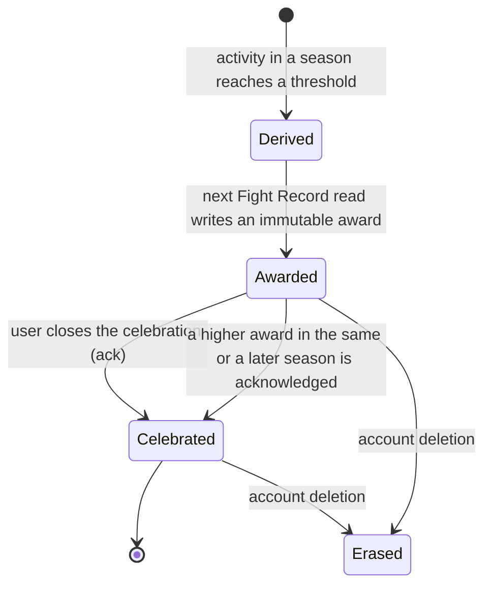
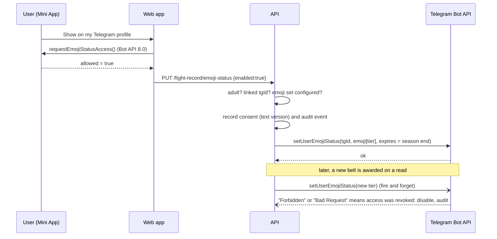
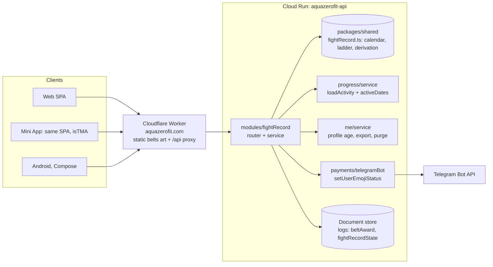
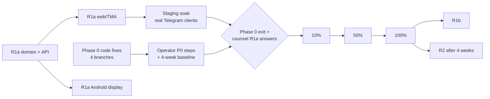

# AZF-W3-05 — Fight Record: Product Requirements and Implementation Plan (v2)

| | |
|---|---|
| Document ID | AZF-W3-05 |
| Version | 2.0 |
| Date | 25 October 2026 (AEDT) |
| Owner | Engineering, Luminara Digital (product owner: founder) |
| Supersedes | AZF-W3-02 PRD v1.0 and AZF-W3-03 Technical Design v1.0 |
| Still current | AZF-W3-01 Research Report, AZF-W3-04 Compliance and Legal Brief |
| Baseline code | `origin/staging` 85d6952 (the same commit v1 was written against) |
| Status | R1a built behind a default-off flag. Release gated on Phase 0 (§1) |

General information for internal planning and for briefing counsel. It is not
legal, tax or financial advice. Statements of law come from AZF-W3-01 and
AZF-W3-04 and must be confirmed by an Australian legal practitioner.

---

## 0. Summary of the revision

The verdict in AZF-W3-01 stands and this document does not reopen it: an
off-chain engagement loop first, behaviour-only credentials second, an optional
on-chain layer last, no token ever. What v1 lacked was contact with the code.
It proposed ten new modules, a second database schema, a migration tool, a
queue, a new deployable and two blockchains, and most of that either duplicates
something the repository already does well or is not needed until a phase that
may never be approved. v2 is written against the code and is buildable as
written: every requirement below names the file that implements it and the
test that proves it.

### 0.1 What changed, and why it matters

| # | v1 said | v2 does | Why |
|---|---|---|---|
| 1 | Phase 0 is nine open blockers | Re-baselined against the code: per-item status, file evidence, in-repo fix branch, operator step (§1) | Two P0s were worse than stated (keyless AI output is **billed**; the origin secret is never enforced). Three are closable in code today |
| 2 | New `w3` Postgres schema, `node-pg-migrate`, `pg` pool | Fight Record data lives in the existing document store (`logs` container) until R3a needs a transactional outbox | The test suite runs on `JsonStore` with no Postgres. A second persistence model would split testing, export and erasure in two. Storing in `logs` makes export and deletion automatic (`me/service.ts` sweeps every `logs` doc by `userId`) |
| 3 | `seasons` table "configured as data" | A pure calendar in `packages/shared` (`fightRecord.ts`): 56-day seasons from one anchor date | No admin tooling exists to edit a table. A pure function gives web, Mini App, API and Android the same answer with no migration, and is exhaustively testable |
| 4 | Belt progress "grace days apply as in the consistency model" | Belts count active days inside the season. A count cannot fall, so there is nothing to forgive | Monotone by construction: no grace bookkeeping, no "lost" state to word carefully, no edge cases |
| 5 | Unit tests "prove no input from weight, calories, macros or body data can change a belt" | The derivation's input type is a set of ISO dates. It cannot see a weight or a calorie | Making the illegal input unrepresentable is stronger than testing for it. A property test still covers the adapter that builds the set |
| 6 | New `share/` module with server-signed share payloads | Reuse `ShareMoment` + `renderShareCard` + `lib/attribution` invite links + growth telemetry, with a new `belt` share kind | The product-as-ad loop already exists and is instrumented. Rebuilding it is cost with no user benefit |
| 7 | `shareToStory` from a client-side canvas PNG | Stories use static per-tier art at `/belts/<tier>.png`, generated by `tools/belts` | `shareToStory(media_url)` takes an **HTTPS URL**, not a blob. The v1 design could not have worked |
| 8 | Emoji status adoption target "10% of TMA WAU" | Target measured against users who can display a status; verify on the staging bot before committing a number | Telegram presents emoji statuses as a Telegram Premium feature. The adoption ceiling is the Premium share of the audience, not all WAU |
| 9 | DB feature-flag table, admin route, 30 s caches, kill switch | Env-backed flags in `platform/config.ts` (the existing pattern) and a deterministic percentage bucket. Turning the flag off is the kill switch | A Cloud Run env change rolls a new revision in under a minute, which meets the 60 s target without new infrastructure. Revisit only when R3a runs a background worker |
| 10 | Coach celebration "uses the existing one-shot achievement line" by extending the reaction pipeline | The celebration sheet renders the active coach's `achievement` line client-side with `renderReaction` | Same voice, zero change to `coaches/reactions.ts`, whose acknowledgement logic is delicate and well tested |
| 11 | Cosmetics in R1 | Moved to R1b, blocked on counsel question C4 (Stars-only price display) and on coach-outfit art that does not exist | Shipping a store with no catalogue is speculative work. The Stars purchase pattern (`payments/stars.ts`) is ready when the art is |
| 12 | R3: TON SBT in Telegram **and** Solana attestation or cNFT on web, an embedded-wallet vendor, three KMS chain keys | R3a **Public Anchor**: one daily Merkle root of issued credentials and pledge results, written by Luminara to one chain. R3b (per-user soulbound seal, TON in Telegram only) only if R2 shows demand and counsel clears it | Delivers the property users actually lack (verification that survives us) with no user wallet, no wallet-to-fitness-app linkage, nothing minted to anyone, one transaction a day, one chain. Most of the AZF-W3-04 §A, §B and §E9–E12 exposure never arises |
| 13 | did:web credentials "survive if AquaZeroFit closes" | did:web dies with the domain. R2 mirrors the issuer keys outside our infrastructure, and R3a anchors key and credential roots | v1's stated value proposition was not met by its own design |
| 14 | Under-18 gating described per feature | One server-side predicate, `adult = profile.age >= 18`. No profile means not adult (fail closed) | Self-declared age is already collected (`profiles.age`, 16 to 100). One predicate cannot drift between surfaces |
| 15 | Bot API calls assumed available | Feature-detected per client: `shareToStory` needs Bot API 7.8, `requestEmojiStatusAccess` and `shareMessage` need 8.0 | Older Telegram clients exist in the target markets, and a call into a missing method throws inside a tap handler |
| 16 | D30 retention "baseline to be measured" | Phase 0 adds an admin cohort report derived from existing activity (no new tracking) | Nothing in the code measures retention today, and the Phase 1 hypotheses are uncheckable without it |

### 0.2 What is built now and what waits

| Release | Contents | Code status | Can go live when |
|---|---|---|---|
| Phase 0 | P0 blockers | In-repo fixes on four branches (§1). Operator steps listed | All P0s verified in production |
| **R1a** | Seasons, Consistency Belts, Fight Record page, dashboard card, celebration, belt share card and Telegram story, Telegram emoji status, guardrail eval cases | **Built** behind `FIGHT_RECORD_ENABLED` (default off) | Phase 0 exit, counsel §C1, C3, E3, E4 and K1 answered, copy review passed |
| R1b | Squad belts in huddles, prepared inline messages, coach cosmetics (Stars) | Specified (§8.4) | R1a live 2 weeks; cosmetics also need counsel C4 and art |
| R2 | Verifiable credentials, verify page, status list, issuer-key mirror | Specified (§9.1) | R1a live 4 weeks, counsel E5 to E8, Privacy Policy updated |
| R3a | Public Anchor (daily Merkle root) | Specified (§9.2) | R2 live, counsel A1, B1, F4 |
| R3b | Per-user soulbound seal, TON in the Mini App | Specified (§9.3) | R3a stable, at least 1% of credential holders ask for it, counsel A, B, E9 to E12, pen test |
| R4 | Proof of Pledge, merch Kit credential | Specified (§9.4) | R3a stable, counsel I and J |
| R5 | Selective disclosure, ZK thresholds, partner API | Research only | Evidence of demand |

Everything before R1a's release is reversible by one environment variable.
Nothing in R2 onward is written until its entry criteria are met: code built
ahead of counsel's answers is code that may have to be rewritten around them.

---

## 1. Phase 0, re-baselined against the code

Audited on `origin/staging` 85d6952 on 25 Oct 2026. One caveat governs the
whole table: `cloudbuild.yaml` deploys with `gcloud run deploy --image`, which
keeps whatever scaling, environment, secrets and ingress the live service
already has, and `deploy/cloudrun/service.yaml` is documentation that is never
applied. The repository alone cannot prove what production runs. Every
"verified" below therefore means verified with `gcloud run services describe`
against the live service.

| P0 | Status in code | Evidence | In-repo fix (branch) | Operator step |
|---|---|---|---|---|
| P0-1 single instance | Partial | `assertSingleInstance()` exists (`platform/config.ts`) but an **unset** `AZF_INSTANCE_COUNT` passes it, and the guard cannot see Cloud Run's max-instances | Deploy pins `--min-instances=1 --max-instances=1` and sets `AZF_INSTANCE_COUNT=1`; on Cloud Run (`K_SERVICE` set) the variable must be explicit (`fix/p0-platform-hardening`) | Confirm with `services describe` after the next deploy |
| P0-2 AI keys | Open, worse than stated | With no provider key the gateway returns mock output with `degraded: false`, and paid lanes **bill credits for template output** (`ai/gateway.ts`, comments in `progress/router.ts` and `recommendations/router.ts`) | In production, keyless mock output is degraded (`no_provider`) so every paid lane releases its credit hold; boot warning when no key is set (`fix/p0-no-billing-for-keyless-mock`) | Add provider keys with spend caps; re-check marketing claims (`Landing.tsx`, `LandingSections.tsx`, `Features.tsx`) against real output |
| P0-3 legal pages | Open | `pages/legal/operator.tsx`: hosting "United States (Replit Reserved VM)", `REVIEW_STATUS = 'draft'`; `Privacy.tsx` omits Stripe, Resend, Cloudflare, Google/Firebase; no APP 8 statement, no OAIC path; claims "no automated export" though `modules/export/export.ts` exists | Factual corrections: Sydney hosting, processors table, APP 8, OAIC path, export (`fix/p0-privacy-facts`). Draft banner stays | Counsel review, then set `REVIEW_STATUS = 'published'`; finish the Terms liability clause |
| P0-4 Stripe lifecycle | Open (staging), partial (PR #44) | `billing/stripe.ts` handles only `invoice.paid` and `customer.subscription.deleted`. PR #44 adds the Customer Portal but no new events, and is 30 commits behind staging | Webhooks for `customer.subscription.updated`, `invoice.payment_failed`, `charge.refunded`, `charge.dispute.created` (`fix/p0-stripe-lifecycle-webhooks`); rebase and merge PR #44 for self-serve cancel | Configure the live Customer Portal; subscribe the webhook endpoint to the new events |
| P0-5 DR | Open | No Cloud SQL configuration in the repo; no recorded restore drill | Commit the `gcloud sql` settings as a script and a restore-drill log section in `docs/OPERATIONS.md` | PITR (7 days), HA or a documented RPO/RTO, one restore drill |
| P0-6 observability | Open | `docs/OPERATIONS.md` states there is no error tracking; no uptime or alert configuration in the repo | Error-tracking SDK in API and web (vendor choice pending); alert policies as code | Create uptime checks and alert routing |
| P0-7 Android origin | Open | Release `API_BASE_URL`/`WEB_BASE_URL` = `https://app.aquazero.fit` (`apps/android/app/build.gradle.kts`); the parent domain is NXDOMAIN; App Links host likewise | Repoint to `https://aquazerofit.com` (`fix/p0-android-release-origin`) | Publish `assetlinks.json` with the Play app-signing SHA-256; rebuild the AAB |
| P0-8 keys, ingress, DB SSL | Ingress open; DB TLS enforced app-side | `platform/clientIp.ts` uses the origin secret only to trust `CF-Connecting-IP` and never rejects a request; `service.yaml` has `ingress: all`. `pgStore.ts` refuses a non-local host without TLS | Opt-in `REQUIRE_ORIGIN_SECRET` middleware: 403 without the Worker's secret, `/health` and `/ready` exempt; boot refusal if enabled without a secret (`fix/p0-platform-hardening`) | Rotate `sk_live` and Resend keys; set the secret on Worker and Cloud Run; move provider webhooks to the apex domain; enable; require SSL on Cloud SQL and drop its public IP |
| P0-9 staging | Open | `.env.staging.example` is placeholders; one Cloud Run service; deploy gates warn instead of failing | Staging Cloud Build substitution for a second service | Create the staging service, database, bot, Stripe test keys and Worker route |
| Exit: Stars Premium price | Not set | `config.telegramStarsPremiumPrice` is null when unset | None | Set `TELEGRAM_STARS_PREMIUM_PRICE` or decide against |
| Exit: retention baseline | Missing | No cohort or retention code anywhere | Admin cohort report (D1, D7, D30 and weekly active loggers per surface) derived from existing activity | Run for 4 weeks before R1a goes live |

Found in passing and added to the Phase 0 list:

- With `ORIGIN_SHARED_SECRET` unset, every user is keyed on the Worker's
  socket address for rate limits and lockouts, so one noisy client can lock
  everyone out. Closing P0-8 closes this.
- Manual `gcloud builds submit` leaves `$COMMIT_SHA` empty, so a manual deploy
  is untagged and unattributable. Deploy from triggers only.
- `Privacy.tsx` admits it has no committed response time. P0-3 adds one.

**Rule:** R1a's code may merge while Phase 0 is open because it ships dark.
`FIGHT_RECORD_ENABLED` is not set in production until every row above reads
verified and the founder has signed the Phase 0 exit.

---

## 2. Product requirements

### 2.1 Problem

Users drop off fast: in app-based activity programmes daily use typically falls
from about 70% at day 7 to about 13% by day 100 (W3-01 [S46]). AquaZeroFit
already measures the right behaviour (showing up, logging, training,
recovering) with unusually careful, outcome-free mechanics. But that progress
is private, it never leaves the app, and it has no beginning or end, so a
lapsed user has no clean moment to come back. The evidence (W3-01 §7) says the
lift comes from visible identity, ritual and small social groups, and the
distribution comes from Telegram's own surfaces. None of it needs a chain.

### 2.2 Goals

| ID | Goal | Measured by (§6.2) |
|---|---|---|
| G1 | Make consistency visible and social: in the app, in Telegram chats and stories, and on the user's Telegram profile | Share rate, story shares, emoji-status adoption |
| G2 | Give every season a start and an end so a lapsed user gets a fresh start with no shame | Return-after-lapse rate |
| G3 | Let a user prove a milestone to anyone without sharing health data (R2) | Credential claims, verify views |
| G4 | Offer an ownership layer that is optional, free and invisible unless chosen (R3) | Seal opt-in, zero value complaints |
| G5 | A fair, deterministic cosmetic revenue line that never touches wellness incentives (R1b) | Cosmetic conversion |
| G6 | Stay inside ASIC, AUSTRAC, ACL, Privacy, classification, Apple, Google and Telegram rules by design | Release checklist, zero guardrail violations |

### 2.3 Non-goals

Carried from v1 unchanged and binding on every release: no token, conversion,
airdrop, staking or "earn"; no transferable or tradeable NFT; no marketplace,
custody or swap; no paid randomness; no crypto or stablecoin payments; nothing
earned unlocks Premium, coaches or features; no credential or ranking derived
from weight, calories or body measurements; no public leaderboards of health
data and none for minors; no `$AZXF`, Solana or aquazero.app content in the
Mini App. v2 adds two: no streak counter anywhere in Fight Record (belts count
days, they do not run), and no countdown or scarcity copy on any belt or
season surface ("days left" is shown as information, never as pressure).

### 2.4 Personas

Unchanged from AZF-W3-02 §5: Mia (everyday web logger), Rizal
(Telegram-native), Jay (AZX fan with a wallet), Grace (privacy-cautious), Tomás
(verifier, R2) and the protected 16-year-old. Grace and the 16-year-old drive
the defaults: nothing in R1a is public unless the user taps it, and nothing
public is offered to a minor.

### 2.5 R1a user stories and acceptance criteria

Each criterion is written to be executable and is mapped to its test in §7.

**US-01 Season and belt on the dashboard.**
Given the feature is on for me, when I open the dashboard, then a Season card
shows the season number and name, its dates in my local calendar, the days
left, my current belt (or "No belt yet") and how many more active days the next
belt needs. It shows no weight, calorie, macro or body figure.

**US-02 Missed days never cost me anything.**
Given I have 14 active days this season, when I miss any number of days, then
my active-day count and belt stay exactly where they were. No copy anywhere
says "lost", "broken", "reset" or "streak".

**US-03 Fresh start.**
Given season N has ended, when I open the app in season N+1, then my progress
starts at 0 active days and my season-N belt appears on my Fight Record shelf
for good.

**US-04 Belts earned while away are still mine.**
Given I was active during a season but did not open Fight Record, when I next
open it, then that season's belt is awarded with the season it was earned in,
and only the highest new belt is celebrated.

**US-05 Celebration, once.**
Given I have earned a belt I have not been shown, when I next load Fight Record
data, then a celebration sheet names the belt and season in my active coach's
voice and offers Share, Show on my Telegram profile (Mini App, adult, supported
client only) and Not now. After I close it, it does not appear again on any
device.

**US-06 Share a belt card.**
When I tap Share, then the existing share sheet renders a belt card (belt,
season, coach line, AquaZeroFit mark) with my invite link, and offers the
native share sheet, Telegram, copy and save. In the Mini App on Bot API 7.8 or
later, and only for adults, it also offers Share to story, which opens
Telegram's story editor with the static belt art and my invite link in the
caption. The card and caption contain no count of days and no health data.

**US-07 Belt as Telegram emoji status (adults, Mini App, Bot API 8.0+).**
When I tap Show on my Telegram profile, then Telegram's own permission prompt
appears. If I allow it, the bot sets my belt emoji as my status, expiring at
season end, and changes it when I earn a higher belt. If I decline, nothing is
stored. One tap on the Fight Record page removes it and stops updates. If I
revoke access inside Telegram, the next failed update turns the feature off for
me without an error on screen.

**US-08 Minors.**
Given my profile age is under 18 (or I have no profile), then Share to story and
the emoji status are not offered, and the server rejects the emoji-status call
with `FORBIDDEN` even if a client sends it.

**US-09 Fight Record page.**
`/fight-record` shows the current season's progress, the full belt ladder with
thresholds, and a shelf with my highest belt from every season, newest first.
Empty, loading, error and populated states are all designed (§2.7).

**US-10 Off means off.**
Given the feature is off for me (flag off, or outside the rollout bucket), then
the API answers `{ "fightRecord": null }`, no card, skeleton, error or sheet
renders on the dashboard, `/fight-record` sends me home, and no belt award is
written. The one write still allowed is withdrawing emoji-status consent, so a
user dropped from the rollout can always take their belt off their profile.

### 2.6 Guardrails, enforcement and proof

| ID | Guardrail | Enforced by | Proved by |
|---|---|---|---|
| GR-01 | Belts never depend on health outcomes | `activeDaysBySeason` takes only ISO dates (`packages/shared/src/fightRecord.ts`) | Type signature; property test that random weights and calories leave the result unchanged (`apps/api/src/__tests__/fightRecord.test.ts`) |
| GR-02 | Nothing earned unlocks Premium, coaches or features | `billing/entitlements.ts` and `coaches/service.ts` untouched; Fight Record has no write path into either | Diff review; no import of Fight Record from either module |
| GR-03 | No paid randomness | R1a sells nothing; R1b catalogue schema has no chance or rarity field | Schema review (R1b) |
| GR-04 | Non-transferable | R1a has nothing to transfer | n/a until R3b |
| GR-05 | No token rewards, no crypto payments | No such code path; Stars, Stripe and Play remain the only rails | Diff review |
| GR-06 | No health or personal data leaves the app | Share card and story carry tier and season only; emoji status is an emoji | Share payload test; story caption test |
| GR-07 | 18+ for public surfaces | `isAdult(profile)` server-side; client hides as well | API test for `FORBIDDEN`; UI test |
| GR-08 | Surface rules: TON only in Telegram, nothing AZX in the Mini App | R1a adds no chain code at all | n/a until R3; bundle scan lands with R3b |
| GR-09 | No dark patterns | Copy rules in §2.7; no countdown component | Copy test asserts banned words are absent from Fight Record strings |
| GR-10 | Coach AI never discusses tokens, NFTs or prices of digital assets | Out-of-scope patterns in `ai/guardrails.ts` extended | New cases in `evals/assistant-safety.json` (the eval step blocks merges) |
| GR-11 | Reversible | `FIGHT_RECORD_ENABLED=false` hides every surface and stops award writes | API test (US-10) |

### 2.7 Copy and state rules

Approved strings live next to the components. Banned in every Fight Record
string: lost, lose, broken, break, reset, streak, hurry, only, last chance,
expires (except in the plain statement "your status clears at season end").
The `/fight-record` page ships four states: loading (skeleton, never a
spinner), empty ("Your first belt is 3 active days away"), error (the shared
`ErrorState` with retry) and populated. The dashboard card is deliberately
different: it renders only once there is data, and nothing while loading, on
error or when the feature is off, because a skeleton that collapses or an error
card about a feature the user does not have would change the dashboard for
everyone during a dark launch. Days left is plain text, never a ring or a
timer.

---

## 3. Domain model

### 3.1 Season calendar

```
SEASON_LENGTH_DAYS  = 56                      // 8 weeks
SEASON_ONE_STARTS_ON = '2026-10-19'           // a Monday; reset to the launch Monday
index(d)   = max(0, floor((d - SEASON_ONE_STARTS_ON) / 56))
startsOn   = SEASON_ONE_STARTS_ON + 56 * index
endsOn     = startsOn + 55
number     = index + 1
id         = 'season-' + number
name       = SEASON_NAMES[index mod 6]
daysLeft   = endsOn - today + 1               // includes today
```

- Dates are the user's local calendar dates (`todayFor(req)`, from
  `X-Timezone`), matching every log's `localDate`. Two users in different zones
  change season a few hours apart, which is correct: a season is a calendar
  span, not an instant.
- Dates before the anchor fall into season 1, so nothing logged before launch
  counts and the function never returns "no season".
- The anchor is set once, to the launch Monday, before the flag is first turned
  on in production, and never moved afterwards: award ids embed the season
  number. Moving it is a one-line reviewed change, which is the right amount of
  friction for something that can only be done once.
- Names rotate through six fighter-camp names (`Fight Camp`, `Ground Game`,
  `Second Wind`, `Ring Craft`, `Long Game`, `Title Run`). They name no
  hemisphere's weather, because half the target markets have none.

### 3.2 Belt ladder

| Tier | Active days in the season | What that is in practice |
|---|---|---|
| White | 3 | Came back twice in the first week |
| Blue | 12 | About 1.5 days a week |
| Purple | 24 | 3 days a week, the weekly-active-logger bar |
| Brown | 36 | 4 to 5 days a week |
| Black | 48 | Six days in seven: room for a day off every week |

An active day is any local date with a meal, water or weigh-in log or a
completed workout: the same definition as XP's `activeDay` and the consistency
model (`progress/service.ts`). A weigh-in counts because stepping on the scale
is showing up; the number on it is never read. The ladder is anchored on the
weekly-active-logger metric so that the habit we measure is the habit we
celebrate, and black stays achievable without daily pressure.

### 3.3 Award lifecycle



- Awards are written on read (the same posture as huddle progress in
  `challenges/service.ts`), with a deterministic id
  `belt-<userId>-s<number>-<tier>`, so a retry or a second tab cannot double
  award. The in-memory store is single-instance and synchronous, so the
  existence check and the write cannot interleave.
- An award is never revoked by later data. Deleting a meal log can lower the
  derived count; the belt stays, like the achievement high-water mark in
  `progress/service.ts`. The current-season tier shown is the higher of the
  derived and the awarded tier.
- Retroactive: every season with activity is evaluated, so a user who never
  opened Fight Record during a season still receives it.
- Celebration state is one high-water mark, `celebratedThrough` (season, then
  tier). Only the top of the shelf can be news, and only if it is above the
  mark; acknowledging raises the mark. A returning user is never walked through
  a queue of stale celebrations, and a log backfilled into a finished season
  cannot resurrect one.

### 3.4 Emoji status lifecycle



The status expires at the end of the season by itself
(`emoji_status_expiration_date`), so a lapsed user's profile clears without any
job and the new season starts clean, which is the fresh-start promise applied
to the profile too.

### 3.5 Gating matrix

| Feature | Web adult | Web minor | Mini App adult | Mini App minor | Android |
|---|---|---|---|---|---|
| Season card, page, belts, celebration | Yes | Yes | Yes | Yes | Yes (display) |
| Share sheet (chats, copy, save) | Yes | Yes | Yes | Yes | Sharesheet |
| Share to story | n/a | n/a | Bot API 7.8+ | No | n/a |
| Emoji status | n/a | n/a | Bot API 8.0+, set configured | No | n/a |
| Cosmetics (R1b) | No (Stars only) | No | Yes | No | No |

---

## 4. Architecture

### 4.1 Components



### 4.2 Module map

| Concern | New | Reused as is |
|---|---|---|
| Calendar, ladder, derivation (pure) | `packages/shared/src/fightRecord.ts` | `gamification.ts` style: dependency-free, shared with the browser |
| Types and request schemas | `packages/shared/src/types/fightRecord.ts`, schemas in `schemas.ts` | zod conventions in `schemas.ts` |
| API | `apps/api/src/modules/fightRecord/{router,service}.ts` | `requireAuth`, `asyncHandler`, `AppError`, `todayFor`, `logEvent`, `auditDataAccess` |
| Activity input | `activeDatesOf` exported from `progress/service.ts` | `loadActivity` (indexed reads) |
| Flags | Three getters in `platform/config.ts` | The existing env-getter pattern |
| Telegram | `setUserEmojiStatus` in `payments/telegramBot.ts` | `callBot` (timeouts, never throws) |
| Export and erasure | none | `me/service.ts` sweeps all `logs` docs by `userId` |
| Web data | `apps/web/src/lib/fightRecord.ts` (hooks and labels) | react-query, `api()`, `envelopes.unwrap` |
| Web UI | `components/fightRecord/{SeasonCard,BeltCelebration,BeltBadge}.tsx`, `pages/fightRecord/FightRecord.tsx` | `GlassCard`, `RingProgress`, `Skeleton`, `ErrorState`, `BottomSheet`, `ShareMoment` |
| Telegram client calls | `shareToStory`, `requestEmojiStatusAccess` wrappers in `lib/telegram.ts` | `telegramSupports(version)` |
| Share card | `belt` kind and belt band in `lib/shareCard.ts` | `renderShareCard`, `ShareMoment`, attribution links, growth events |
| Static art | `tools/belts/build-belt-art.mjs` → `apps/web/public/belts/*.png`; emoji-pack tool | sharp, as in `tools/cards` |
| Android | `feature/fightrecord` screen, `SeasonCard` in `core/ui`, API model in core | Existing Retrofit/Room/Compose layers |

### 4.3 API contract (R1a)

All routes are under `/api/v1`, require auth, and follow the named-envelope
convention.

**`GET /fight-record`** → `200 { fightRecord: FightRecordStatus | null }`

```json
{
  "fightRecord": {
    "current": {
      "season": { "id": "season-3", "number": 3, "name": "Second Wind",
                  "startsOn": "2027-03-01", "endsOn": "2027-04-25" },
      "activeDays": 14, "daysLeft": 23, "tier": "blue",
      "next": { "tier": "purple", "activeDays": 24 }
    },
    "ladder": [ { "tier": "white", "activeDays": 3 }, "…" ],
    "belts": [ { "id": "belt-…-s3-blue", "seasonNumber": 3, "seasonName": "Second Wind",
                 "tier": "blue", "awardedAt": "2027-03-19T02:10:00.000Z" } ],
    "celebrate": null,
    "adult": true,
    "emojiStatus": { "available": true, "enabled": false }
  }
}
```

`null` when the feature is off for the caller (US-10). `belts` holds the
highest award per season, newest season first. The response never contains a
weight, calorie or user id.

**`POST /fight-record/ack`** `{ awardId: string }` → `204`. Unknown or foreign
award ids are a no-op `204` (nothing to acknowledge), so a stale client cannot
probe ids.

**`PUT /fight-record/emoji-status`** `{ enabled: boolean }` →
`200 { emojiStatus: { available, enabled } }`. Errors when enabling:
`FORBIDDEN` (minor, no linked Telegram account, emoji set not configured, or
feature off for the user), `CONFLICT` (Telegram refused the status; nothing is
stored). Disabling always succeeds, inside or outside the rollout.

### 4.4 Data

Both document types live in the `logs` container, keyed so the existing
`logs.userId+type` index serves every read.

```ts
interface BeltAward {          // immutable
  type: 'beltAward';
  id: `belt-${string}-s${number}-${BeltTier}`;
  userId: string;
  seasonId: string; seasonNumber: number;
  tier: BeltTier;
  activeDays: number;          // the threshold met, not the user's total
  awardedAt: string;           // ISO
}

interface FightRecordState {   // one per user, written only on change
  type: 'fightRecordState';
  id: `fight-record-${string}`;
  userId: string;
  celebratedThrough: { seasonNumber: number; tier: BeltTier } | null;
  emojiStatus:                 // a union: "off but remembering a status" cannot be stored
    | { enabled: false }
    | { enabled: true; consentTextVersion: string;
        lastSet: { seasonId: string; tier: BeltTier } | null };
  updatedAt: string;
}
```

Export includes both (the `logs` sweep). Account deletion erases both (the
`logs` purge). An emoji status already set on Telegram expires at season end;
deletion also clears it best-effort before the account goes. Consent grants and
withdrawals are additionally written to the append-only `audit` container with
the consent text version, which `purgeUser` anonymises rather than deletes.

**When relational tables arrive.** R3a's anchor job needs a transactional
outbox that survives a restart mid-submission, which the document store's
asynchronous write-behind cannot promise. That is the first point at which a
`w3` schema earns its cost, and it should arrive together with the P0-1
Postgres read path so the platform has one relational story, not two.

### 4.5 Configuration and rollout

| Variable | Default | Effect |
|---|---|---|
| `FIGHT_RECORD_ENABLED` | `false` | Master switch and kill switch for every R1a surface and award write |
| `FIGHT_RECORD_ROLLOUT_PERCENT` | `100` | Share of users (0 to 100) inside the rollout, by a stable hash of the user id. Set but unparseable (`10%`, `12.5`) means 0: a typo fails toward nobody |
| `TELEGRAM_BELT_EMOJI_IDS` | unset | JSON object, tier → custom emoji id. Emoji status is offered only when all five are present and the bot token is real |

Bucket: `parseInt(sha256('fight-record:' + userId).slice(0, 8), 16) % 100 <
percent`. Stable per user, so raising the percentage only ever adds people.
Turning the master switch off takes effect on the next revision (under a
minute on Cloud Run). Awards already written stay and reappear when it is
turned back on.

### 4.6 Telegram specifics

- `shareToStory(media_url, { text })` needs Bot API 7.8 and an HTTPS URL. The
  media is `https://aquazerofit.com/belts/<tier>.png` (1080×1920, static,
  public, cacheable, contains no personal data). The caption carries the invite
  link and stays within the 200-character limit for non-Premium users. Links as
  a story widget are Premium-only and are not used.
- `requestEmojiStatusAccess` needs Bot API 8.0. The server then calls
  `setUserEmojiStatus(user_id, emoji_status_custom_emoji_id,
  emoji_status_expiration_date)`; an empty id removes the status.
- The custom emoji set is provisioned once by the operator with
  `tools/belts/create-emoji-set.mjs` (Bot API `createNewStickerSet`,
  `sticker_type: custom_emoji`, 100×100 PNGs from `tools/belts`). It prints the
  JSON for `TELEGRAM_BELT_EMOJI_IDS`.
- Assumption to verify on the staging bot before setting any adoption target:
  Telegram presents emoji statuses as a Premium feature, so non-Premium users
  may grant access and still not display a status.

---

## 5. Security, privacy and compliance

### 5.1 Threat model deltas (R1a)

| Threat | Example | Control |
|---|---|---|
| Tampering | Client claims a belt | Belts derive server-side from stored logs; the client sends no progress |
| Tampering | Replay or forge an ack for someone else's award | Ack resolves the award by id and user id; foreign ids are a silent no-op |
| Information disclosure | Belt reveals health status to contacts | Emoji status and story are opt-in, adult-only, carry tier and season only; consent recorded |
| Information disclosure | Enumerating awards | Award ids never appear in public routes; every route requires auth |
| Elevation | Minor enables public features with a crafted request | Server-side `isAdult` check on the only public-facing write |
| Denial of service | A read storm writes awards | Writes happen only for new tiers (at most five per season per user); idempotent ids |
| Abuse | Farming belts with throwaway accounts | Belts carry no value, unlock nothing, and are not transferable |
| Harm | Over-logging to earn | Belts count days, not logs; one log per day is as good as twenty |

### 5.2 What leaves the app

| Surface | Contents | Never contains |
|---|---|---|
| Share card (PNG) | Belt tier, season number and name, coach line, wordmark | Day counts, weight, calories, name, user id |
| Story | Static tier art; caption with belt, season and invite link | As above |
| Emoji status | One custom emoji | Anything else |
| Invite link | Existing attribution ref (`inviteRefFromUserId`) | Raw user id |

### 5.3 Compliance mapping

| Requirement | v2 handling | Release |
|---|---|---|
| CR-02 Privacy Policy covers new processing | Emoji status (Telegram) and sharing added to the policy before release; credentials, wallets and chains before R2/R3 | R1a, R2, R3 |
| CR-03 Separate explicit consent | Telegram's own prompt plus a stored consent record with text version for emoji status | R1a |
| CR-04 Terms: belts are licences with no money value | Terms clause drafted with counsel (W3-04 §C1) | R1a |
| CR-06 No chance-based paid items | Design decision recorded here; R1b schema review | R1b |
| CR-07 Play declaration before any Android mint | Android stays display-only through R3 | R3 |
| CR-08 Telegram §6 and §7 checklist per release | W3-04 §5.1 checklist in the release checklist (§8.8) | Every release |
| CR-11 WCAG 2.2 AA for new screens | Keyboard, focus-visible, labels, contrast checked in component tests and review | R1a |

Counsel priorities follow W3-04 §4.0. R1a needs C1 (Terms wording), C3 (copy
and flows under the UTP Act), E3 and E4 (emoji status and share cards as
possible health-information disclosure) and K1 (age-gate adequacy). The
cosmetics question C4 moves with cosmetics to R1b.

---

## 6. Observability and metrics

### 6.1 Events

Server (`logEvent`, structured, no raw identifiers):

| Event | Fields | When |
|---|---|---|
| `fight_record_belt_awarded` | `tier`, `seasonNumber`, `retroactive` | An award is written |
| `fight_record_emoji_status_set` | `tier` | Telegram accepted a status |
| `fight_record_emoji_status_failed` | `tier`, `revoked` | Telegram refused; `revoked` when the feature was turned off for the user |

Audit (`audit` container): `fightRecord.emojiStatus.granted`,
`fightRecord.emojiStatus.withdrawn`, each with the consent text version.

Client (existing growth telemetry, no new event names): `share_opened`,
`share_native`, `share_telegram`, `share_copied` with `kind: 'belt'`, and
`share_telegram` with `channel: 'story'` for stories.

### 6.2 Metrics (all targets are hypotheses, read against the Phase 0 baseline)

| Metric | Definition | Hypothesis | Decision rule |
|---|---|---|---|
| D30 retention | Share of a signup cohort active on days 28 to 31 | +10 to 20% relative | Below +5% after 8 weeks: rethink R1b before building it |
| Return after lapse | Share of users inactive 14+ days who are active in the first 14 days of a new season | +10% relative | Below baseline: seasons are not working as a fresh start; revisit names and copy |
| Belt reach | Share of season-active users who earn at least white | 60% | Below 40%: white threshold too high |
| Share rate | `share_*` with `kind: 'belt'` per 100 WAU per week | 3 | |
| Story share | `share_telegram` with `channel: 'story'` per 100 adult TMA WAU | Measure first | |
| Emoji-status adoption | Users with status enabled over adult TMA WAU on Bot API 8.0+ | Measure first (Premium ceiling, §4.6) | |
| Guardrail: over-logging | Share of users logging more than 8 meals a day | No increase | Any increase: investigate before widening rollout |
| Guardrail: floor advisories | Calorie-floor clamp events per 1,000 users | No increase | As above |

### 6.3 Alerts

`fight_record_emoji_status_failed` above 5% of attempts over an hour (Telegram
change or revoked set); any 5xx from `/fight-record` routes above the API
baseline; award write rate above five per user per season (a derivation bug).

---

## 7. Testing strategy

| Layer | What | Where |
|---|---|---|
| Pure domain | Season boundaries (anchor, day 55/56, pre-anchor, leap years, DST-free date math), ladder thresholds at n−1/n, derivation monotonicity, next-rung arithmetic | `packages/shared/src/fightRecord.test.ts` |
| Property | Random activity with random weights, calories and macros: belt depends only on dates; adding a day never lowers the result | `apps/api/src/modules/fightRecord/fightRecord.test.ts` |
| Service | Award on read, idempotent ids, retroactive seasons, never revoked after log deletion, celebration choice and ack subsumption, rollout bucket stability, adult predicate (fail closed) | same |
| API | Every route: auth, flag off → `null` and no writes, `FORBIDDEN` for minors and unavailable emoji set, `CONFLICT` on Telegram refusal, envelope shape, export contains and purge removes both doc types | `apps/api/src/__tests__/fightRecord.integration.test.ts` |
| Telegram client | Request shape for `setUserEmojiStatus`, empty-id removal, revoked-access disable | API test with `fetch` stubbed |
| Web | Season card four states, page shelf, celebration actions and ack, gating by `isTMA`, version and `adult`, banned-copy scan | `apps/web/src/components/fightRecord/*.test.tsx`, `pages/fightRecord/*.test.tsx` |
| Eval | Coach refuses NFT, token, airdrop and digital-asset price questions | `evals/assistant-safety.json` |
| Android | Model parsing, card rendering states | `apps/android/app/src/test/...` |
| Manual staging | Real Telegram client on 7.8 and 8.0+, emoji set, story editor, Premium and non-Premium accounts | Release checklist |

---

## 8. Implementation plan

Estimates are engineer-days for one senior full-stack engineer, as ranges.

### 8.1 Critical path



### 8.2 Phase 0 tasks

| ID | Task | Owner | Est. | Done when |
|---|---|---|---|---|
| P0-1.1 | Pin one instance in every deploy; require explicit instance count on Cloud Run | Eng | 0.5 | Branch merged; `services describe` shows min = max = 1 |
| P0-2.1 | Keyless mock output degraded in production; boot warning | Eng | 0.5–1 | Branch merged; no credit spent on a keyless call in a production-mode test |
| P0-2.2 | Provider keys with spend caps; marketing claims checked against real output | Ops, founder | 1 | Real vision and coach output in production |
| P0-3.1 | Privacy factual corrections | Eng | 1 | Branch merged |
| P0-3.2 | Counsel review; publish legal pages | Founder, counsel | external | `REVIEW_STATUS = 'published'` |
| P0-4.1 | Stripe lifecycle webhooks | Eng | 1–2 | Branch merged; events subscribed in the live dashboard |
| P0-4.2 | Rebase and merge PR #44 (Customer Portal, cancel on erasure); fix cancel wording in Terms and Refund | Eng | 0.5–1 | Merged; portal live |
| P0-5.1 | PITR, HA or RPO/RTO, restore drill, drill log | Ops | 1–2 | Drill recorded in `docs/OPERATIONS.md` |
| P0-6.1 | Error tracking (API, web, bot), uptime checks, alert routing | Eng, ops | 1–2 | Test alert reaches the on-call channel |
| P0-7.1 | Android release origin; `assetlinks.json`; rebuild AAB | Eng, ops | 0.5 | App Links verify on a device |
| P0-8.1 | Origin-secret enforcement (opt-in) | Eng | 0.5–1 | Branch merged; run.app returns 403 once enabled |
| P0-8.2 | Rotate keys; webhooks to apex; enable enforcement; Cloud SQL SSL and no public IP | Ops | 0.5 | All verified |
| P0-9.1 | Staging service, database, bot, Stripe test keys, Worker route | Ops, eng | 1–2 | Staging smoke passes |
| P0-10 | Admin retention cohort report (D1, D7, D30, weekly active loggers by surface) | Eng | 1 | Report runs; 4 weeks of baseline captured |

### 8.3 R1a tasks (built on `feat/fight-record`)

| ID | Task | Files | Est. | Done when |
|---|---|---|---|---|
| FR1-01 | Calendar, ladder and derivation, pure and shared | `packages/shared/src/fightRecord.ts`, types, schemas | 1 | Domain tests pass |
| FR1-02 | Service: activity → progress, awards on read, celebration, rollout bucket, adult predicate | `apps/api/src/modules/fightRecord/service.ts`, `progress/service.ts` (export `activeDatesOf`), `platform/config.ts` | 1.5 | Service and property tests pass |
| FR1-03 | Routes and Telegram emoji status | `modules/fightRecord/router.ts`, `modules/index.ts`, `payments/telegramBot.ts` | 1 | API tests pass |
| FR1-04 | Coach guardrail: NFT, token, airdrop and digital-asset price questions | `ai/guardrails.ts`, `evals/assistant-safety.json` | 0.5 | `npm run eval` green with new cases |
| FR1-05 | Web data layer and Telegram wrappers | `apps/web/src/lib/fightRecord.ts`, `lib/telegram.ts` | 0.5 | Unit tests pass |
| FR1-06 | Season card on the dashboard | `components/fightRecord/SeasonCard.tsx`, `pages/dashboard/Dashboard.tsx` | 1 | Four states tested |
| FR1-07 | Fight Record page and route | `pages/fightRecord/FightRecord.tsx`, `App.tsx` | 1 | Page tests pass |
| FR1-08 | Celebration sheet, belt share card, story share, emoji-status consent | `components/fightRecord/BeltCelebration.tsx`, `lib/shareCard.ts`, `components/share/ShareMoment.tsx` | 1.5 | Interaction tests pass |
| FR1-09 | Belt art and emoji-pack tooling | `tools/belts/*`, `apps/web/public/belts/*` | 0.5 | Art committed; tool documented in `tools/README.md` |
| FR1-10 | Android display: season card and Fight Record screen | `apps/android/...` | 2–3 | `./gradlew ktlintCheck detekt test` green |
| FR1-11 | Copy and dark-pattern review; accessibility pass | all of the above | 0.5 | Banned-copy test passes; keyboard and screen-reader walk-through done |
| FR1-12 | Staging soak with real clients; rollout | ops | 2 | Release checklist signed |

### 8.4 R1b tasks (specified, not built)

| ID | Task | Notes |
|---|---|---|
| FR1b-01 | Squad belts: each huddle member's current-season tier (not counts) on the huddle card, with a per-user "show my belt to my huddles" setting | Reuses `challenges/service.ts`; adds one setting; member names already pass the profanity filter |
| FR1b-02 | Prepared inline messages (`savePreparedInlineMessage` + `shareMessage`, Bot API 8.0) for a rich "join my huddle" card | Server saves per user; client feature-detects |
| FR1b-03 | Coach cosmetics: fixed catalogue (no chance fields), Stars invoices via the `payments/stars.ts` pattern, equip, refund, adults and Mini App only | Blocked on counsel C4 and on outfit art |

### 8.5 Definition of done (every task)

1. Code follows the module's existing conventions and comment style; no file
   crosses 1,000 lines.
2. Tests for new behaviour; for a fix, the failing test first.
3. `npm run verify` green (typecheck, tests, eval); Android tasks also
   `./gradlew ktlintCheck detekt test`.
4. Review: correctness, security, maintainability (the ponytail, pstack and
   thermo-nuclear passes), and every finding fixed or written down.
5. Four UI states designed; keyboard and screen-reader path checked.
6. Docs updated where behaviour or operations changed.

### 8.6 Release checklist (R1a)

- [ ] Every Phase 0 row verified in production; founder sign-off recorded.
- [ ] Counsel answers on C1, C3, E3, E4 and K1 received; Terms and Privacy updated.
- [ ] `SEASON_ONE_STARTS_ON` set to the launch Monday (one-line change, merged before enabling).
- [ ] Belt emoji set provisioned on the production bot; `TELEGRAM_BELT_EMOJI_IDS` set.
- [ ] Staging: real Telegram clients on Bot API 7.8 and 8.0+, one Premium and one non-Premium account; story and emoji status verified; result recorded.
- [ ] Telegram checklist W3-04 §5.1 T1 to T8 passed (T6 applies).
- [ ] Dashboards for §6.2 live; alerts for §6.3 routed.
- [ ] `FIGHT_RECORD_ENABLED=true`, `FIGHT_RECORD_ROLLOUT_PERCENT=10`; after 7 days with guardrails flat, 50; after 7 more, 100.

### 8.7 Rollback

Set `FIGHT_RECORD_ENABLED=false`. Every surface disappears on the next
revision; written awards stay and return when re-enabled; emoji statuses
expire at season end on their own. No migration exists to roll back.

---

## 9. Gated releases: technical design

### 9.1 R2 Proof of Consistency (verifiable credentials)

- **Format.** W3C VC Data Model 2.0 secured as a compact JWS
  (`application/vc+jwt`), `alg: EdDSA` over Ed25519. Node's built-in
  `crypto.sign(null, …)` signs Ed25519; no JOSE library is needed for issuing,
  and the interop test uses an independent verifier.
- **Claims allowlist.** `beltTier`, `seasonId`, `seasonName`,
  `activeDaysThreshold`, `validFrom`, subject `urn:azf:subject:<hmac>` where the
  HMAC key is a Secret Manager pepper. Nothing else, enforced by a schema with
  `additionalProperties: false`, tested.
- **Keys.** Cloud KMS `EC_SIGN_ED25519`, HSM, `australia-southeast1`, signer
  permission for the API service account on that key only. A signer interface
  keeps KMS behind one function so tests sign with a local key.
- **Status.** Bitstring Status List v1.0, one list of 131,072 entries per
  credential, published at `/credentials/status/1` as a signed list credential,
  cached at the edge for five minutes so a revocation is visible within the
  five-minute target. The list document lives in a new non-user-scoped store
  location so erasure of one user can flip a bit without deleting the list.
- **Issuer identity and survivability.** `did:web:aquazerofit.com`, DID document
  proxied by the Worker from the API. Because did:web cannot outlive the
  domain, every issuer public key is also published in this repository
  (`docs/issuer/jwks.json`, signed tags) and anchored in R3a. A verifier holding
  a credential can check it against either source.
- **Verify page.** `/verify/:id`, public, no tracking beyond aggregate counts,
  random 128-bit ids, its own rate-limit lane, shows issuer, tier, season,
  status and signature result, and explains offline verification.
- **Erasure.** Deleting a credential or the account flips the status bit first,
  then deletes our copy.
- **Tasks.** KMS key and signer (1–2 days); credentials module with issue, list,
  revoke, delete and status list (3–4); verify page and lane (2); credential
  sheet with QR and export, Android credential view (2–3); interop test (1);
  rollout (1). Exit: 99.9% verify success, revocation under five minutes, four
  weeks of claim and verify data.

### 9.2 R3a Public Anchor (replaces per-user minting as the default)

Once a day a job computes a Merkle root over (a) the SHA-256 of every
credential JWS issued that day, (b) the current status-list hash, (c) the
issuer JWKS hash and (d) any closed pledge result. Luminara submits that one
root in one transaction to one chain (TON, so the same story holds inside
Telegram) from a KMS-held key. Each credential export gains its Merkle path and
the transaction reference.

What this delivers: a third party can check a credential's existence, issue
date, issuer key and revocation state without contacting AquaZeroFit, after
AquaZeroFit is gone. What it avoids: no wallet for the user, no address linked
to a fitness app, nothing minted or held by anyone but us, one fee a day, no
embedded-wallet vendor, no second chain, no bundle-scan risk in the Mini App.
It needs the first relational table (the anchor outbox, §4.4) and one small
worker task; it is roughly a third of v1's Phase 3 effort.

### 9.3 R3b Seal (optional, per user)

Only if R2 shows at least 1% of credential holders asking for an on-chain copy,
counsel clears W3-04 §A, §B and §E9 to E12, and a pen test is booked. Scope it
to TON in the Mini App via the unmodified `@tonconnect/ui-react` (TEP-85 SBT or
TON Society cSBT), user signs a `ton_proof` link message only, we pay fees, kill
switch, Android display-only. Solana on web stays out unless a separate
decision brings it in. The v1 design for both chains remains the reference if
that decision is ever made.

### 9.4 R4 Proof of Pledge and Kit

Pledges reuse huddles for enrolment, derive progress from activity on read
(the huddle pattern), and publish the result and the SHA-256 of the donation
receipt into the next R3a root, so the public attestation costs nothing extra.
The Kit credential is an R2 credential issued on Stripe
`checkout.session.completed` for merch, display-only, one per order. Counsel J
(state fundraising law) and I gate it.

---

## 10. Risks

| Risk | Likelihood | Impact | Mitigation |
|---|---|---|---|
| Fight Record ships before Phase 0 is truly closed | Medium | High | Default-off flag; release checklist requires per-row production verification |
| Emoji status is Premium-limited and adoption looks poor | High | Low | Target measured against eligible users; feature is cheap to keep |
| Belts read as streak pressure | Medium | High | Count-based, cannot be lost, banned-copy test, guardrail metrics gate each rollout step |
| Season anchor moved after launch | Low | Medium | Launch checklist; award ids embed season numbers; changing it later is visibly wrong in review |
| Telegram changes story or emoji APIs | Low | Medium | Feature detection; both are additive to a working share sheet |
| Old Telegram clients break on missing methods | Medium | Low | Every call gated on `isVersionAtLeast` |
| Health-information concerns about public belts (W3-04 E3, E4) | Medium | High | Adult-only, opt-in, tier and season only; counsel answer is a release gate |
| Building R2+ before evidence | Medium | Medium | Entry criteria in §0.2; nothing is coded early |
| Users treat belts as investments (R3) | Medium | High | R3a mints nothing to users; R3b gated on demand and counsel |

---

## 11. Decisions requested

| # | Decision | Default if no answer |
|---|---|---|
| 1 | Launch Monday for season 1 | The first Monday after Phase 0 sign-off |
| 2 | Belt thresholds (3, 12, 24, 36, 48) | As proposed; revisit after one season of data |
| 3 | Error-tracking vendor for P0-6 | Sentry (free tier covers current volume) |
| 4 | Whether R3 ever goes beyond R3a | Decide after R2 data; do not build R3b speculatively |
| 5 | Stars Premium price | Decide before Phase 0 exit |

---

## 12. Traceability from v1

| v1 ID | Disposition in v2 | Where |
|---|---|---|
| US-01, US-02, US-03 | Kept; acceptance criteria made executable | US-01 to US-04 |
| US-04 (emoji status) | Kept; Premium caveat, expiry at season end, revoke handling | US-07, §3.4 |
| US-05 (share card) | Kept; story uses static art | US-06, §4.6 |
| US-06 (squad view) | Moved to R1b | FR1b-01 |
| US-07 (cosmetics) | Moved to R1b; counsel C4 | FR1b-03 |
| US-08 (minors) | Kept; one server-side predicate | US-08, §3.5 |
| US-10 to US-14 (credentials) | Kept for R2 | §9.1 |
| US-20 to US-26 (seal) | Replaced by R3a by default; R3b conditional and TON-only | §9.2, §9.3 |
| US-30 to US-32 (pledge, kit) | Kept for R4; attestation via R3a | §9.4 |
| FR-API-01 seasons table | Replaced by a pure calendar | §3.1 |
| FR-API-02 fightRecord module | Kept | FR1-02, FR1-03 |
| FR-API-03 health-independence tests | Strengthened: by type, plus property test | GR-01 |
| FR-API-04 cosmetics | R1b | FR1b-03 |
| FR-API-05 emoji status | Kept | FR1-03 |
| FR-API-06 credentials | R2 | §9.1 |
| FR-API-07 wallets, FR-API-08 anchoring | R3b only / R3a redesign | §9.2, §9.3 |
| FR-API-09 pledges | R4 | §9.4 |
| FR-API-10 flags, region, age, kill switch | Env flags + bucket + adult predicate; region gating arrives with R3b | §4.5, §3.5 |
| FR-API-11 `w3_*` tables | Deferred to R3a's outbox | §4.4 |
| FR-API-12 existing patterns | Kept | §4.2 |
| FR-API-13 export and deletion | Automatic for R1a via the `logs` sweep; R2 adds status-bit flip | §4.4, §9.1 |
| FR-API-14 coach refuses token questions | Kept, with eval cases | FR1-04 |
| FR-WEB-01 to FR-WEB-03 | Kept (`CredentialSheet` in R2) | FR1-06 to FR1-08, §9.1 |
| FR-WEB-04 verify page | R2 | §9.1 |
| FR-WEB-05, FR-WEB-06 seal dialog, surface gating | R3b only | §9.3 |
| FR-WEB-07 web cosmetics | R1b; Stars only | FR1b-03 |
| FR-TMA-01, FR-TMA-02 | Kept; prepared inline messages to R1b | FR1-08, FR1b-02 |
| FR-TMA-03 to FR-TMA-06 | R1b / R3b | §8.4, §9.3 |
| FR-AND-01 | Kept | FR1-10 |
| FR-AND-02 | R2 | §9.1 |
| FR-AND-03 | Kept (no mint, no purchase) | §3.5 |
| FR-AND-04 offline cache | Kept, using the app's existing Room cache layer | FR1-10 |
| TD §5 Cloud Tasks and anchor worker | Replaced by one daily R3a job | §9.2 |
| TD §6 DB flags and admin route | Replaced by env flags | §4.5 |
| TD §11 rollout | Rewritten with gates and percentages | §8.6 |
